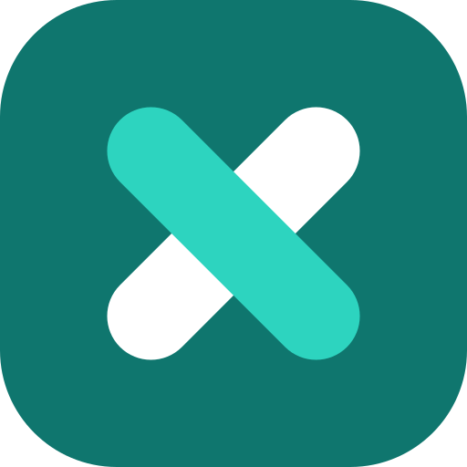

### Software a medida · Productos SaaS · Sitios web · Infraestructura · Soporte

Soluciones tecnológicas integrales desde Cobán, Guatemala 🇬🇹

## 📦 Nuestros productos

| Producto | ¿Qué resuelve? | Estado |
|---|---|---|
|  **[xaCare](https://care.xacode.dev)** | Gestión hospitalaria y clínica: pacientes, ingresos, quirófano (QxLog), honorarios y cotizaciones de cirugía |  |
|  **[xaTiende](https://xatiende.com)** | Atención al cliente por WhatsApp: bandeja compartida, bot de menús y flujos, asistente inteligente (Olmar), catálogo y pedidos |  |
|  **[xaSeguros](https://seguros.xacode.dev)** | Seguimiento de reclamos a aseguradoras: tablero Kanban, regla del 25, calculadora de participaciones, consolidaciones FEL |  |
|  **xaPedidos** | Tienda móvil con marca propia por negocio: el cliente arma su pedido, confirma por WhatsApp y le da seguimiento |  |
|  **xaFleet** | Gestión de flota vehicular: vehículos, conductores, mantenimientos y recorridos |  |
| 🌐 **xaWeb** | Servicio de diseño, desarrollo y gestión de sitios web (Astro + CMS editable por el cliente) |  |

## 🚀 ¿Qué hacemos?

| Área | Descripción |
|---|---|
| 🖥️ **Desarrollo de software** | Sistemas a medida, aplicaciones web, APIs y automatizaciones con Laravel y Livewire. Rescate y modernización de sistemas heredados |
| 🌐 **Sitios web (xaWeb)** | Sitios institucionales rápidos y bilingües, con panel para que el cliente edite su contenido. Migraciones desde WordPress |
| ☁️ **Hosting e infraestructura** | Hosting administrado, Cloudflare, SSL, respaldos diarios, correo corporativo y monitoreo |
| 🔧 **Reparación y mantenimiento** | Equipos de cómputo, formateos, mantenimiento preventivo y diagnóstico técnico |
| 🌐 **Redes** | Diseño e instalación de redes cableadas e inalámbricas |
| 📷 **Cámaras de seguridad** | Instalación y configuración de sistemas CCTV con acceso remoto |
| 📊 **Consultoría técnica** | Asesoría en tecnología para empresas y emprendedores |

## 🤝 Clientes

| Cliente | Sector | Trabajo realizado |
|---|---|---|
| **[Hospital Nuestra Señora del Carmen](https://hospitalcoban.com)** | Salud · Cobán | Sitio web institucional bilingüe con CMS propio (Lighthouse móvil 37 → 99), inventario de equipos, xaCare, xaSeguros y piloto de xaTiende |
| **Farmacias Farco** | Farmacia | Rescate de emergencia de su sistema Pharmasys tras la pérdida del servidor en Heroku e integración de facturación electrónica FEL (SAT) |
| **Waffle** | Alimentos | Primer negocio en xaPedidos: tienda móvil con marca propia y pedidos por WhatsApp |
| **[NawokPOS](https://nawokpos.com)** | Software · POS | Rediseño de su sitio web con identidad propia y modo oscuro |

## 🛠️ Stack tecnológico

Pruebas automatizadas con Pest/PHPUnit · CI/CD con GitHub Actions · Despliegues en Laravel Cloud y VPS propio

---

*Software a medida. Soporte que responde.*

